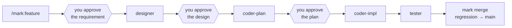
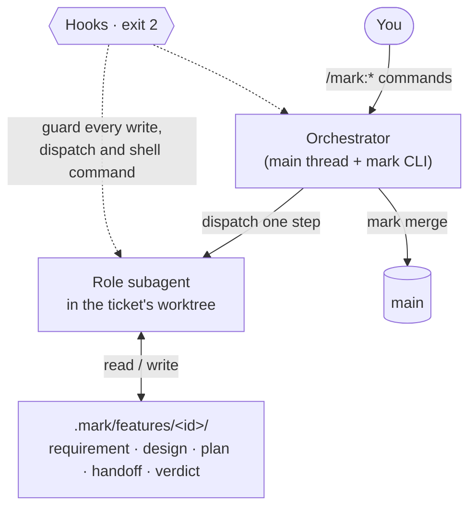

<div align="center">
  <h1>Mark</h1>
  <h3><em>A dev team of Claude Code agents, with rules they can't skip.</em></h3>
  <p>
    <a href="https://github.com/tuoyukun/MarkSuits/tags"></a>
    <a href="https://github.com/tuoyukun/MarkSuits/actions/workflows/ci.yml"></a>
    <a href="LICENSE"></a>
  </p>
  <p><strong>English</strong> · <a href="README.zh-CN.md">简体中文</a></p>
</div>

Mark is a [Claude Code](https://code.claude.com) plugin (from the MarkSuits marketplace) that
turns one coding agent into a small team: a designer, a planner, an implementer, a tester and a
bug planner. Each works in its own git worktree, writes only the files its role owns, and hands
off through files on disk. You approve the design and the plan. Hooks block every step that
breaks the process, so the rules hold even when the agent would rather skip them.



## Quickstart

```bash
claude plugin marketplace add tuoyukun/MarkSuits --scope project
claude plugin install mark@marksuits --scope project
```

Then, in Claude Code inside your repository:

```text
/mark:init                                        # read the repo, propose a setup, write it on your OK
/mark:feature Add a "Clear completed" button      # requirement → design → plan → code → test → merge
```

To try it without touching your own code, run an example in a sandbox:
[examples/README.md](examples/README.md).

## Why Mark

Coding agents are good at writing code, but over a long session they lose track of decisions,
mark their own homework, and treat the rules in `CLAUDE.md` as suggestions. Mark keeps that
from happening:

- **Fresh context every step.** Each step runs a new subagent that reads only the artifacts it
  needs (requirement, approved design, plan), not a long chat history.
- **Separation of duties.** The tester writes end-to-end tests and a verdict, never production
  code. The implementer never edits the plan, the design or those tests. A failure goes back to
  the role that owns it.
- **You review at two points.** The design (with a working UI preview) and the technical plan.
  After that the chain runs to the merge on its own. Bug fixes run with no gates.
- **Rules enforced by code.** Hooks exit 2 on writes outside a role's scope, skipped gates,
  duplicate dispatches, commits on the wrong branch, and an agent approving its own work.
- **Parallel work that doesn't collide.** One branch, worktree and set of ports per ticket.
  Code reaches main only through `mark merge`: the core-flow regression, then fast-forward. If
  anything fails, main is untouched.
- **A process that stays lean.** Byte budgets on the docs every agent loads; the tester writes
  one acceptance test per criterion, and only core flows join the regression suite.

## How Mark compares

[Superpowers](https://github.com/obra/superpowers), [Spec Kit](https://github.com/github/spec-kit)
and [BMad Method](https://github.com/bmad-code-org/BMAD-METHOD) are excellent and much more
widely used. They give the agent a method. Mark gives it a method *and refuses the tool calls
that break it*.

| | Mark | Superpowers | Spec Kit | BMad Method |
|---|---|---|---|---|
| What it is | Ticket workflow with role agents and a merge pipeline | Library of composable skills | Spec-driven toolkit: commands and templates | Agile method with specialized agents and workflows |
| How the process holds | Hooks block violating tool calls (exit 2) | The agent follows the skills | The agent follows the commands | The agent follows the workflows |
| Coding agents | Claude Code only | Many | Many | Many |
| Who lands the code | `mark merge`, after the regression suite | You choose: merge, PR, keep or discard | You | You |

**When not to use Mark**

- You use a coding agent other than Claude Code.
- Your changes are small and quick. A ticket with design and plan reviews is overhead for a
  one-line fix (Mark's `/mark:general` lane handles docs and config, not code).
- You can't give it a git remote and worktrees, or you don't want agents to push branches.
- You want it stable. Mark is pre-1.0 and changes often.
- Token cost matters more than process. Several fresh agents per ticket cost more than one long
  session.

## What you type

| You want to | Type | What happens |
|---|---|---|
| Build a feature | `/mark:feature [--discuss] <what>` | discussion → requirement → your review → design → your review → plan → your review → code → design check → test → merge |
| Fix a bug | `/mark:fix <what>` | fix plan → code → test → merge, no review gates |
| Accept or send back a review | `/mark:approve <id>`, `/mark:reject <id> <why>` | the chain continues, or the role reworks it |
| Change docs or config | `/mark:general <what>` | edited on a throwaway branch, landed through the same regression |
| See where things stand | `/mark:status` | every ticket, and what waits on you |
| Upgrade the project files | `/mark:upgrade` | 3-way merge of the new template, landed when you say so |

On [`examples/todo`](examples/README.md#walkthrough), one bug and one feature went from request
to main in about 25 minutes of agent time and roughly $6 of tokens. The human typed two requests,
answered a few questions, and approved one design and one plan.

## How it works



- **The orchestrator never guesses.** It asks `mark next <id>`, which answers dispatch, wait,
  record, stop or merge. `mark dispatch` prepares the branch, worktree and ports, and prints the
  exact agent and prompt. [More](docs/architecture.md#orchestration-v04)
- **Tickets are folders.** Each feature or bug has a folder of artifacts and a `status.md`.
  There is no shared board file to conflict on, and only the `mark` CLI moves a ticket's
  status. [More](docs/architecture.md#tickets-and-the-mark-cli)
- **Gates are files only a human can create.** No tool call can write a gate or a status, the
  orchestrator's included. `mark approve` checks that you typed `/mark:approve`.
  [More](docs/architecture.md#4-ticket-lifecycle-feature-chain)
- **Guards are small, tested functions.** Every hook goes through one entry point, and each guard
  returns a message or nothing. Outside a Mark project they stay silent.
  [More](docs/architecture.md#guards-v03)
- **Tests have two homes.** Each ticket's acceptance tests live in `e2e/tickets/<id>/`, one per
  criterion; only the few core flows live in `e2e/regression/`, the suite `mark merge` runs.
  [More](docs/architecture.md#end-to-end-tests-v022)
- **One way into main.** `mark merge` merges main into the ticket, runs the core-flow regression,
  then fast-forwards and pushes. [More](docs/architecture.md#merge-v07)

Role agents, prompts and artifact formats ship with the plugin and update with it. Your project
keeps only `CLAUDE.md` and `.mark/config.toml`, plus any built-in it overrides with a file of the
same name. [More](docs/architecture.md#built-ins-and-overrides-v017)

## Profiles

`/mark:init` picks one from your repository. The profile sets the modules, the roles and the
end-to-end test runner.

| Profile | For | Example |
|---|---|---|
| `web-fullstack` | web frontend + backend, Playwright | [`todo`](examples/todo/) |
| `web-frontend` | web app without its own backend | [`expenses`](examples/expenses/) |
| `service` | API or service, no UI and no designer | [`notes`](examples/notes/) |
| `mobile-fullstack` | mobile app + backend, Maestro | [`habits`](examples/habits/) |
| `mobile` | mobile app with data on the device | [`tally`](examples/tally/) |

## Principles

- **Enforced, not suggested.** A rule counts only if a hook blocks it with exit 2.
- **Files are the only channel.** Agents never talk to each other; artifacts on disk carry
  everything.
- **Information flows downstream.** Requirement → design → plan → code → test.
- **Humans make the decisions.** Opening a ticket, approving a design and approving a plan are
  never an agent's call.

## Status

v0.40. Feature and bug chains have run end to end on all five examples. Versions stay below 1.0
until real users have run Mark. Claude Code does not auto-update plugins from this marketplace
unless you turn it on (`/plugin` > Marketplaces > marksuits > Enable auto-update); `mark status`
tells you when a newer version is out.

## Documentation

- [Architecture](docs/architecture.md): every guard, state and decision, with the reasons
- [Examples and walkthroughs](examples/README.md)
- [Contributor rules](CLAUDE.md)

## Development

```bash
python3 -m unittest discover -s tests -t .  # engine and template tests (stdlib only)
python3 tools/sync_example.py               # after a template change
claude plugin validate .
claude --plugin-dir ./plugins/mark          # load the local plugin for one session
git config core.hooksPath tools/git-hooks   # sensitive-data pre-commit check
```

## License

[MIT](LICENSE)
