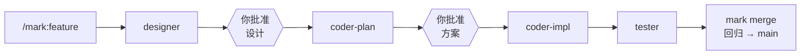
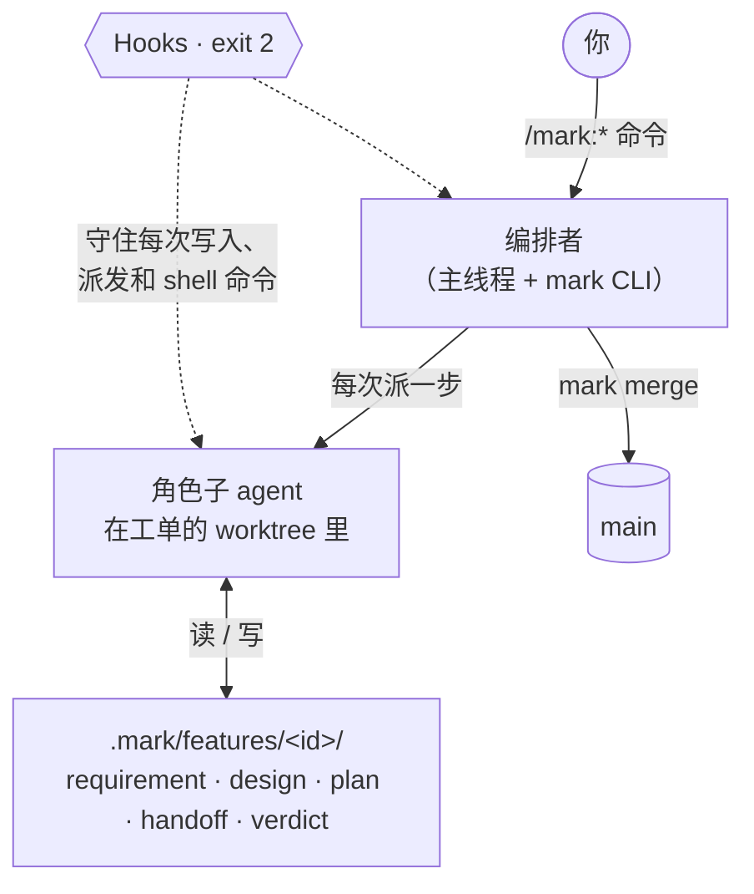

<div align="center">
  <h1>Mark</h1>
  <h3><em>一支由 Claude Code agent 组成的研发团队，规则绕不过去。</em></h3>
  <p>
    <a href="https://github.com/tuoyukun/MarkSuits/tags"></a>
    <a href="https://github.com/tuoyukun/MarkSuits/actions/workflows/ci.yml"></a>
    <a href="LICENSE"></a>
  </p>
  <p><a href="README.md">English</a> · <strong>简体中文</strong></p>
</div>

Mark 是一个 [Claude Code](https://code.claude.com) 插件（来自 MarkSuits marketplace），把一个编码 agent
变成一支小团队：设计、技术方案、实现、测试、bug 分析。每个角色在自己的 git worktree 里工作，只能写
自己负责的文件，通过落盘文件交接。你批准设计和方案；hook 拦下每一个违反流程的步骤，所以即使 agent
想偷懒，规则也照样成立。



## 快速开始

```bash
claude plugin marketplace add tuoyukun/MarkSuits --scope project
claude plugin install mark@marksuits --scope project
```

然后在仓库里打开 Claude Code：

```text
/mark:init                                        # 读仓库、给出配置草案，你确认后写入
/mark:feature 加一个"清除已完成"按钮               # 设计 → 方案 → 代码 → 测试 → 合并
```

不想动自己的代码，可以先在沙箱里跑示例：[examples/README.md](examples/README.md)。

## 为什么用 Mark

编码 agent 擅长写代码，但会话一长，就会忘掉之前的决定、自己给自己打分，还把 `CLAUDE.md` 里的规则
当成建议。Mark 防止这些事发生：

- **每一步都是干净的上下文。** 每一步启动一个新的子 agent，只读它需要的制品（需求、已批准的设计、
  方案），不继承冗长的对话历史。
- **职责分离。** tester 只写端到端测试和结论，不碰生产代码；coder-impl 不改方案、设计和这些测试。
  失败退回给负责的角色。
- **你只在两处审。** 设计（附可运行的 UI 预览）和技术方案。之后整条链自动跑到合并。bug 修复没有闸门。
- **规则由代码强制。** 越权写入、跳过闸门、重复派发、提交到错误分支、agent 自己批准自己的工作，
  hook 一律 exit 2 拦截。
- **并行不打架。** 一单一分支、一个 worktree、一组端口。代码只能经 `mark merge` 进 main：先跑全量回归，
  再 fast-forward；任何一步失败，main 不动。
- **流程保持精简。** 每个 agent 都加载的文档有字节预算；只有方案说明已有用户旅程无法扩展时，才新增
  端到端测试。

## 和同类工具比较

[Superpowers](https://github.com/obra/superpowers)、[Spec Kit](https://github.com/github/spec-kit) 和
[BMad Method](https://github.com/bmad-code-org/BMAD-METHOD) 都很优秀，用户也多得多。它们给 agent 一套方法；
Mark 给 agent 一套方法，**并拒绝违反它的工具调用**。

| | Mark | Superpowers | Spec Kit | BMad Method |
|---|---|---|---|---|
| 是什么 | 带角色 agent 和合并流水线的工单流程 | 可组合的 skill 库 | 规格驱动的工具包：命令和模板 | 敏捷方法，配专门的 agent 和工作流 |
| 流程靠什么维持 | hook 拦截违规的工具调用（exit 2） | agent 遵循 skill | agent 遵循命令 | agent 遵循工作流 |
| 支持的编码 agent | 仅 Claude Code | 多种 | 多种 | 多种 |
| 谁把代码合进去 | `mark merge`，全量回归通过后 | 你选：合并、PR、保留或丢弃 | 你 | 你 |

**什么时候不该用 Mark**

- 你用的不是 Claude Code。
- 你的改动又小又快。带设计审和方案审的工单，对一行修复来说是负担（`/mark:general` 车道只处理文档和
  配置，不处理代码）。
- 你没法提供 git 远端和 worktree，或者不希望 agent 推送分支。
- 你需要稳定。Mark 还在 1.0 之前，变化频繁。
- 比起流程你更在意 token 花费。每个工单启动多个新 agent，比一个长会话更贵。

## 你会输入什么

| 你想要 | 输入 | 会发生什么 |
|---|---|---|
| 做一个功能 | `/mark:feature <内容>` | 设计 → 你审 → 方案 → 你审 → 代码 → 设计验收 → 测试 → 合并 |
| 修一个 bug | `/mark:fix <内容>` | 修复方案 → 代码 → 测试 → 合并，没有评审闸门 |
| 通过或打回评审 | `/mark:approve <id>`、`/mark:reject <id> <原因>` | 链继续往下走，或由对应角色返工 |
| 改文档或配置 | `/mark:general <内容>` | 在一次性分支上修改，经同样的回归落地 |
| 看整体进度 | `/mark:status` | 所有工单，以及哪些在等你 |
| 升级项目文件 | `/mark:upgrade` | 三方合并新模板，你点头才落地 |

在 [`examples/todo`](examples/README.md#walkthrough) 上，一个 bug 和一个功能从提出到进 main，共用约 25 分钟
agent 时间、约 6 美元 token。人只输入了两条需求，回答了几个问题，批准了一份设计和一份方案。

## 工作原理



- **编排者从不猜。** 它问 `mark next <id>`，得到 dispatch、wait、record、stop 或 merge 之一。
  `mark dispatch` 准备好分支、worktree 和端口，输出确切的 agent 和提示词。
  [详情](docs/architecture.md#orchestration-v04)
- **工单即目录。** 每个 feature 或 bug 一个目录，装着制品和 `status.md`。没有会冲突的全局看板文件，
  只有 `mark` CLI 能改工单状态。[详情](docs/architecture.md#tickets-and-the-mark-cli)
- **闸门文件只有人能创建。** 任何工具调用都写不了闸门和状态，编排者也不行。`mark approve` 会检查
  你确实输入了 `/mark:approve`。[详情](docs/architecture.md#4-ticket-lifecycle-feature-chain)
- **守卫是有测试的小函数。** 所有 hook 经过同一个入口，每个守卫返回一条消息或什么都不返回。
  在非 Mark 项目里完全静默。[详情](docs/architecture.md#guards-v03)
- **进 main 只有一条路。** `mark merge` 先把 main 合进工单分支，跑你的回归命令，再 fast-forward 并推送。
  [详情](docs/architecture.md#merge-v07)

角色 agent、派活模板和制品格式随插件发布、随插件更新。项目里只保留 `CLAUDE.md` 和 `.mark/config.toml`，
以及用同名文件覆盖的内置文件。[详情](docs/architecture.md#built-ins-and-overrides-v017)

## Profile

`/mark:init` 根据你的仓库选一个 profile，它决定模块、角色和端到端测试框架。

| Profile | 适用 | 示例 |
|---|---|---|
| `web-fullstack` | web 前端 + 后端，Playwright | [`todo`](examples/todo/) |
| `web-frontend` | 没有自有后端的 web 应用 | [`expenses`](examples/expenses/) |
| `service` | API 或服务，没有 UI，也没有 designer | [`notes`](examples/notes/) |
| `mobile-fullstack` | 移动应用 + 后端，Maestro | [`habits`](examples/habits/) |
| `mobile` | 数据存在设备上的移动应用 | [`tally`](examples/tally/) |

## 设计理念

- **强制，而不是建议。** 只有被 hook 以 exit 2 拦下的规则才算数。
- **文件是唯一的通道。** agent 之间从不对话，所有信息都在落盘的制品里。
- **信息只向下游流动。** 需求 → 设计 → 方案 → 代码 → 测试。
- **决定由人来做。** 开单、批准设计、批准方案，从来不由 agent 决定。

## 状态

v0.31。feature 链和 bug 链已在全部五个示例上端到端跑通。在真实用户跑过之前，版本号保持在 1.0 以下。
Claude Code 默认不会自动更新这个 marketplace 里的插件，需要你打开一次（`/plugin` > Marketplaces >
marksuits > Enable auto-update）；有新版时 `mark status` 会提示。

## 文档

- [架构](docs/architecture.md)（英文）：每个守卫、状态和决定，以及背后的原因
- [示例与演练](examples/README.md)
- [贡献者规则](CLAUDE.md)

## 开发

```bash
python3 -m unittest discover -s tests -t .  # 引擎与模板测试（仅标准库）
python3 tools/sync_example.py               # 改了模板之后
claude plugin validate .
claude --plugin-dir ./plugins/mark          # 本次会话加载本地插件
git config core.hooksPath tools/git-hooks   # 提交前的敏感信息检查
```

## 许可证

[MIT](LICENSE)
