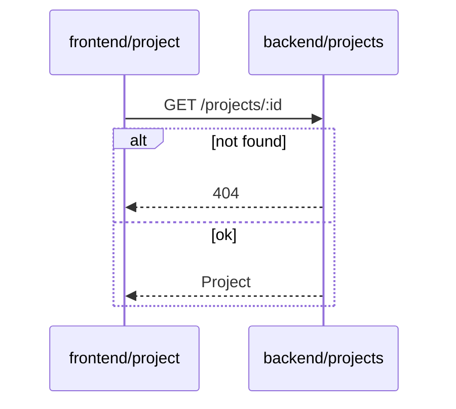

# Format: tech-plan.md

Written by coder-plan; reviewed by the human at `review-plan`; read only for everyone after.

~~~markdown
# <id> · Technical plan

## Data model
<new or changed entities, fields, migrations; or "no change">

## Interfaces
<APIs, events, module contracts: signature, input, output, errors>

## Module changes
| module | change | depends on |
|---|---|---|

## Sequence diagrams
### SD-1 · <flow> (AC-1, AC-2)

## Tasks
<!-- mark:tasks -->
- T-1: <concrete change> (SD-1; AC-1)
- T-2: …

## End-to-end path
<how a user gets from the entry point to done after this ticket; where it still breaks>

## Self-check
- reused: <existing module/helper → used in T-N>
- built anyway: <what, why an existing one could not be extended>
- searched: <where you looked>

## ADRs
- <ADR ids written or affected, or "none">

## Risks and open questions
<!-- mark:open-questions -->
- none
~~~

Rules:

- Every `AC-N` is covered by at least one `T-N`, or marked "tester" when only an end-to-end
  test delivers it; every `T-N` appears in some `SD-N`.
- Every `T-N` is coder-impl's work: nothing in the UI directory (designer) or the end-to-end
  test directory (tester).
- Sequence diagrams are Mermaid `sequenceDiagram` and include failure branches.
- No changelog section: rework history goes in commit messages, citing `R-N`.
