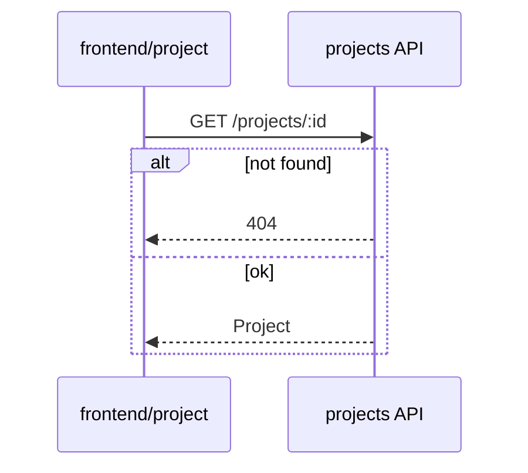

# Format: tech-plan.md

Written by coder-plan; reviewed by the human at `review-plan`; read only for everyone after.

~~~markdown
# <id> · Technical plan

## Data model
<new or changed entities, fields, migrations; or "no change">

## Interfaces
<APIs, events, module contracts: signature, input, output, errors>

## Module changes
| module | change | depends on |
|---|---|---|

## Sequence diagrams
### SD-1 · <flow> (AC-1, AC-2)

## Tasks
<!-- mark:tasks -->
- T-1: <concrete change> (SD-1; AC-1)
- T-2: …

## End-to-end path
<how a user gets from the entry point to done after this ticket; where it still breaks>

## End-to-end coverage
<!-- mark:e2e-plan -->
| AC | action | test | suite | steps to add / why no existing test fits |
|---|---|---|---|---|
| AC-1 | new | <title of this ticket's short test> | acceptance | <what it proves> |
| AC-2 | extend | <exact title of a living regression journey> | regression | <steps to add, and after which existing step> |
| AC-3 | unit | - | - | <covered by a unit test (coder-impl)> |

## Self-check
- reused: <existing module/helper → used in T-N>
- built anyway: <what, why an existing one could not be extended>
- searched: <where you looked>

## ADRs
- <ADR ids written or affected, or "none">

## Risks and open questions
<!-- mark:open-questions -->
- none
~~~

Rules:

- Every `AC-N` is covered by at least one `T-N`, or marked "tester" when only an end-to-end
  test delivers it; every `T-N` appears in some `SD-N`.
- Every `T-N` is coder-impl's work: nothing in the UI directory (designer) or the end-to-end
  test directory (tester).
- **End-to-end coverage:** read `<tests>/JOURNEYS.md` first. Every `AC-N` gets at least one
  row; a short test may cover a cluster of criteria, listed together in the AC cell. `suite`
  is `acceptance`, `regression` or `-`.
- `acceptance` is the default and is `new`: one short flow per cluster a user can verify
  independently, with the exact title it will get. Do not default to `extend`: acceptance
  tests from merged tickets are frozen.
- A `regression` row records the effect on a full path: `extend` the living main journey
  whose path already passes through the changed state, and say which steps to add. When the
  change touches no full path, write `| AC-N | - | none | regression | none |`. Never extend
  a frozen historical flow.
- `-` with `unit` is a criterion no user action reaches; coder-impl covers it with a unit
  test. `extend`, `new` and `unit` are literal in every language. The human reviews new
  tests here; the tester may add no others.
- Sequence diagrams are Mermaid `sequenceDiagram` and include failure branches.
- No changelog section: rework history goes in commit messages, citing `R-N`.
