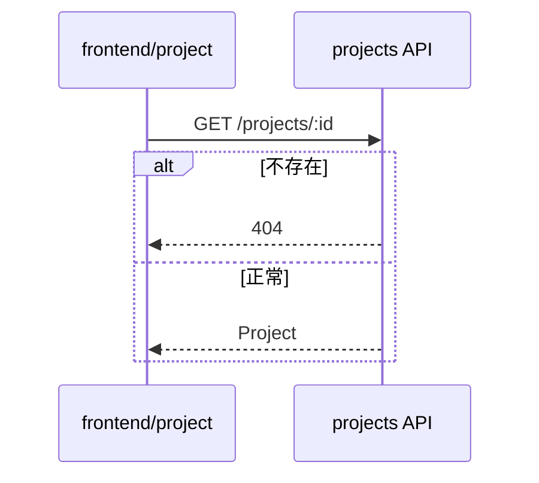

# 格式：tech-plan.md

由 coder-plan 写；在 `review-plan` 由人审阅；此后对所有人只读。

~~~markdown
# <编号> · 技术方案

## 数据模型
<新增或变更的实体、字段、迁移；或「无变更」>

## 接口
<API、事件、模块契约：签名、输入、输出、错误>

## 模块改动
| 模块 | 改动 | 依赖 |
|---|---|---|

## 时序图
### SD-1 · <流程>（AC-1、AC-2）

## 任务拆解
<!-- mark:tasks -->
- T-1：<具体改动>（SD-1；AC-1）
- T-2：……

## 完整使用路径
<本单做完后用户从入口到完成怎么走；哪里还断着>

## 自查
- 已复用：<既有模块/工具 → 用在 T-N>
- 坚持新建：<什么，为什么不能扩展既有实现>
- 排查过：<查过哪些地方>

## ADR
- <新写或受影响的 ADR 编号，或「无」>

## 风险与待确认
<!-- mark:open-questions -->
- 无
~~~

规则：

- 每条 `AC-N` 至少被一个 `T-N` 覆盖；只有端到端测试能交付的，标「tester」。每个 `T-N` 都出现在
  某张 `SD-N` 里。
- 每个 `T-N` 都是 coder-impl 的活：不落在 UI 目录（designer）或端到端测试目录（tester）。
  不要写用例标题、suite 或步骤：tester 按每个 AC 写一个验收用例，并自行判断回归影响。
- 时序图用 Mermaid `sequenceDiagram`，并画出失败分支。
- 不设 changelog 段：返工历史写在 commit 正文里，引用 `R-N`。
